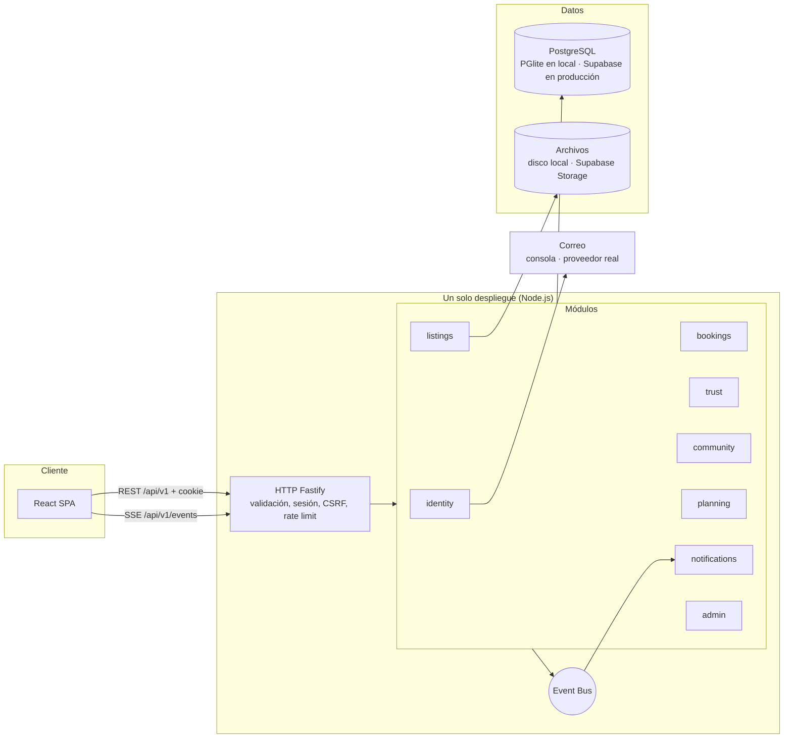
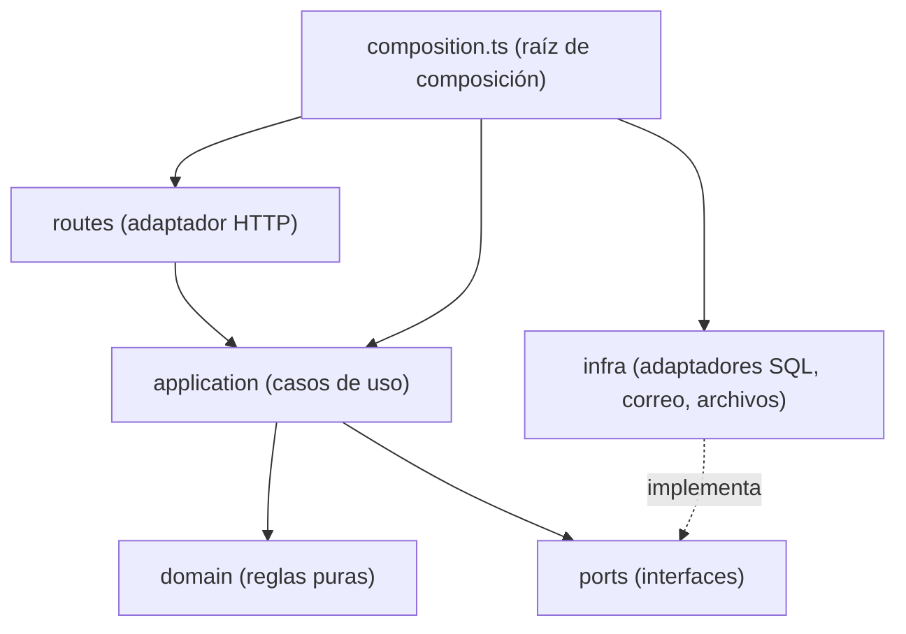
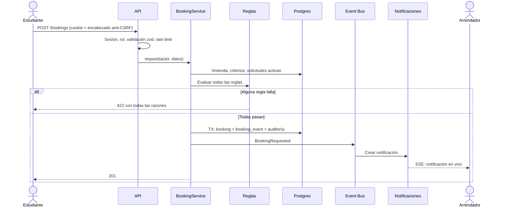
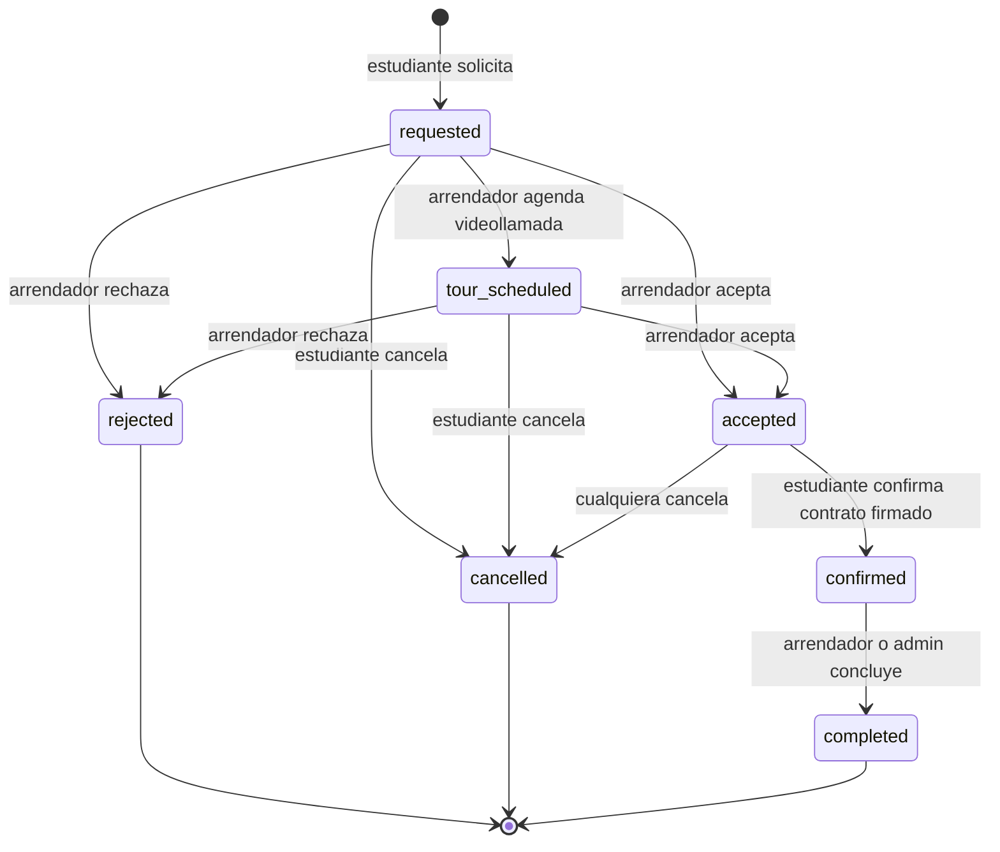
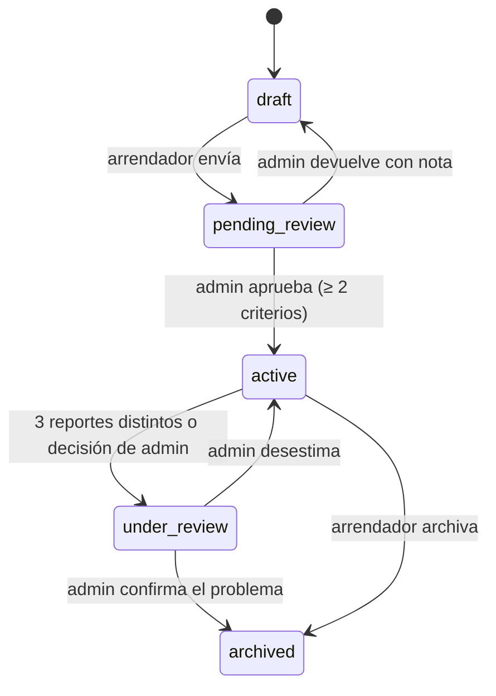

# 04 · Arquitectura

## Decisión

**Monolito modular con arquitectura hexagonal (puertos y adaptadores)**, una SPA en React y PostgreSQL. En producción, Postgres y Storage los provee **Supabase**.



### Por qué esta arquitectura

| Opción | Ventaja | Por qué sí o no |
| --- | --- | --- |
| **Monolito modular + hexagonal** ✅ | Reglas de seguridad y de negocio en un solo lugar, un despliegue, módulos que pueden separarse después | Encaja con un equipo pequeño y un MVP con muchas reglas de confianza |
| React → Supabase directo (RLS) | Menos código | La lógica crítica (máquina de estados, umbrales, antifraude) quedaría repartida en políticas SQL y funciones, difícil de probar |
| Microservicios | Escala por equipo | Costo operativo injustificado para este tamaño |
| MVC plano | Rápido al inicio | Las reglas terminan mezcladas con HTTP y SQL |

### Capas de cada módulo

La dependencia siempre apunta hacia adentro:



| Carpeta | Responsabilidad | Prohibido importar |
| --- | --- | --- |
| `modules/*/domain.ts` | Reglas puras | Fastify, SQL, Node I/O |
| `modules/*/service.ts` | Casos de uso, orquestación | Fastify |
| `modules/*/repository.ts` | Adaptador SQL. **Hoy solo existe en `listings`**; ver deuda técnica abajo | Otros módulos |
| `modules/*/routes.ts` | HTTP ↔ caso de uso | SQL |
| `composition.ts` | Crea e inyecta dependencias | — |

> **Deuda técnica conocida.** En `identity`, `bookings`, `trust`, `community`, `notifications`, `planning` y `admin`, el SQL todavía vive dentro del servicio, detrás del puerto `Db`. Las reglas sí están separadas en `domain.ts` y la base de datos es intercambiable, pero esos servicios mezclan orquestación y consultas. Sacar el SQL a repositorios es la siguiente mejora de calidad; las pruebas de integración protegen ese cambio.

## Estructura del repositorio

```text
project/
├── CLAUDE.md                # Contexto para retomar el trabajo
├── docs/                    # Esta documentación
├── apps/
│   ├── api/                 # Fastify + TypeScript
│   │   ├── migrations/      # SQL versionado
│   │   ├── src/
│   │   │   ├── config/      # Variables de entorno validadas
│   │   │   ├── platform/    # Base de datos, correo, archivos, eventos, auditoría
│   │   │   ├── http/        # Servidor, seguridad, errores
│   │   │   ├── modules/     # Un módulo por contexto de negocio
│   │   │   ├── seed/        # Datos de demostración
│   │   │   └── composition.ts
│   │   └── test/
│   └── web/                 # React + Vite
│       └── src/
│           ├── app/         # Rutas, proveedores
│           ├── design/      # Tokens y componentes base
│           ├── features/    # Una carpeta por área de negocio
│           └── lib/         # Cliente de API
└── packages/
    └── contracts/           # Esquemas zod compartidos entre API y web
```

## Módulos

| Módulo | Responsabilidad | Tablas |
| --- | --- | --- |
| `identity` | Registro, sesión, validación, perfil | `users`, `sessions`, `one_time_codes`, `student_verifications` |
| `listings` | Viviendas, zonas, búsqueda, sello, alerta de precio, fotos | `zones`, `listings`, `listing_photos`, `listing_cost_items`, `listing_criteria` |
| `bookings` | Solicitudes y máquina de estados | `bookings`, `booking_events` |
| `trust` | Reseñas, reportes, señales de estafa | `reviews`, `reports` |
| `community` | Mentores, conversaciones, mensajes | `mentor_profiles`, `conversations`, `messages` |
| `planning` | Calculadora, guías, checklist | `cost_assumptions`, `guides`, `checklist_tasks`, `checklist_progress` |
| `notifications` | Notificaciones y tiempo real | `notifications` |
| `admin` | Colas, auditoría, métricas | `audit_log` |

Los módulos se comunican por el **bus de eventos** o por interfaces inyectadas, nunca leyendo las tablas de otro para escribir.

## Flujos clave

### Solicitar una vivienda



### Máquina de estados de la solicitud



### Publicar una vivienda



## Registro de decisiones (ADR)

| # | Decisión | Motivo | Consecuencia / costo |
| --- | --- | --- | --- |
| 1 | Monolito modular hexagonal | Ver arriba | Hay que cuidar los límites entre módulos |
| 2 | **Fastify** + TypeScript | Rápido, buen modelo de plugins, esquemas | — |
| 3 | **PGlite en local, Postgres/Supabase en producción** | Demo sin instalar nada; un puerto `Db` con dos adaptadores | Hay que probar ambos antes de lanzar |
| 4 | **Sesiones propias** en vez de Supabase Auth | Reglas de validación universitaria en el mismo dominio; revocación inmediata; sin dependencia para la demo | Asumimos la responsabilidad: Argon2id, bloqueo, recuperación. Migrar a Supabase Auth o agregar MFA antes de lanzar si el equipo lo prefiere |
| 5 | SQL parametrizado sin ORM | Consultas transparentes y portables; patrón Repository | Mapeo manual |
| 6 | **RLS activado sin políticas** en todas las tablas | Supabase expone `public` por PostgREST; esto lo bloquea por defecto. La API se conecta como propietaria | La API sigue siendo la única puerta. No hay que usar las llaves `anon` en el navegador |
| 7 | **SSE** para tiempo real | Solo se necesita servidor → cliente; más simple que WebSocket | Bus en memoria = una instancia. En la demo con varias instancias, la web consulta cada pocos segundos como respaldo. Para producción, `LISTEN/NOTIFY` o Supabase Realtime |
| 8 | Montos en MXN enteros | Evita errores de punto flotante | Otra moneda requiere un objeto `Money` |
| 9 | La plataforma no mueve dinero | Ver alcance | El valor se concentra en verificar e informar |
| 10 | Mismo origen en producción | La API sirve la SPA; simplifica CSP, cookies y CORS | Escalado conjunto |
| 11 | Esquemas zod compartidos | Una sola definición para validar en cliente y en servidor | Paquete interno extra |
| 12 | CSS propio con tokens, sin kit de componentes | Identidad propia | Más CSS que mantener |

## Stack

| Capa | Tecnología |
| --- | --- |
| Web | React 19, Vite, React Router, TanStack Query, Leaflet |
| API | Node 24, Fastify 5, TypeScript, zod |
| Datos | PostgreSQL (PGlite / `pg`) |
| Seguridad | Argon2id, `@fastify/helmet`, `@fastify/rate-limit`, `@fastify/cookie` |
| Pruebas | Vitest (dominio e integración sobre PGlite en memoria) |
| Entrega | Docker, GitHub Actions |

## Demo pública en Vercel

Para compartir el avance con el equipo. `vercel.json` despliega web y API juntas. Vercel levanta varias instancias de la API en cuanto hay peticiones en paralelo, así que el estado no puede vivir en memoria: la base es un Postgres de **Neon**, plan gratuito en `iad1`, instalado desde el Marketplace de Vercel y exclusivo de la demo.

| Variable | Valor |
| --- | --- |
| `PUBLIC_DEMO` | `true` |
| `DEMO_GATE`, `DEMO_ACCESS_PASSWORD` | Opcionales. Con `DEMO_GATE=on` la demo pide contraseña compartida (12 caracteres o más, usuario `equipo`). Sin eso, la demo es abierta |
| `DATABASE_URL`, `DATABASE_URL_UNPOOLED` | Las inyecta la integración de Neon (con pooler y directa) |
| `DEMO_DATABASE` | `dedicated`: declara que la base solo tiene datos ficticios |
| `APP_SECRET` | 64 caracteres aleatorios, común a todas las instancias (firma los códigos de verificación) |

- **Arranque:** cada instancia migra y siembra por la conexión directa con un candado de Postgres (`pg_advisory_lock`). Si arrancan varias a la vez, una trabaja y las demás encuentran todo hecho. Comprobado con tres instancias simultáneas contra Neon.
- **Consultas:** por el pooler de Neon, cinco conexiones como máximo por instancia, TLS 1.3 con certificado verificado.
- **Sin `DEMO_DATABASE=dedicated` y `APP_SECRET`, la app no arranca:** las cuentas de demo, con contraseña conocida, jamás conviven con una base real.
- **Tiempo real:** el aviso por SSE solo llega si quien escribe cayó en la misma instancia. Mensajes, solicitudes y notificaciones también se consultan cada 4 a 15 segundos mientras la pestaña está visible.
- **Fotos:** no se aceptan fotos nuevas (`uploadsEnabled: false`), porque las instancias no comparten disco. Las fotos de demostración son estáticas.
- **Límite de frecuencia:** cuenta por instancia, así que en la demo es más laxo que en un solo proceso. Con la demo abierta es la única defensa contra abuso, junto con los límites por cuenta.
- **Reiniciar datos:** `npx vercel env run -e production -- npm run db:reset-demo -w @aterriza/api -- --confirmar`, desde una carpeta vinculada al proyecto. Solo actúa si la base tiene la cuenta de administración de demostración.

**No es el despliegue de producción.** Para eso, ver la siguiente sección y los bloqueantes de `08-seguridad.md`.

## Pasar a Supabase

Lo que hará falta de ti cuando llegue el momento:

1. Crear un proyecto en Supabase y copiar la cadena de conexión (Session pooler) en `DATABASE_URL`.
2. `npm run db:migrate` aplica las mismas migraciones.
3. Descargar el certificado CA de Supabase y poner su ruta en `DATABASE_CA_CERT`: la conexión exige verificar TLS.
4. Crear un bucket de fotos y escribir el adaptador `SupabaseStorage` (el puerto `FileStore` ya existe). Hasta entonces, las fotos van a un disco persistente.
5. Implementar un adaptador real de `Mailer`: **la app no arranca en producción sin él**.
6. **Nunca** poner la llave `service_role` en el frontend. Esta arquitectura no necesita ninguna llave de Supabase en el navegador.
