# 06 · Base de datos

PostgreSQL. Identificadores `uuid`, fechas `timestamptz`, montos en MXN enteros. Los valores cerrados usan `CHECK`, que es más fácil de migrar que un `ENUM`. Definición fuente: `apps/api/migrations/`.

## Diagrama entidad-relación

```mermaid
erDiagram
  users ||--o{ sessions : tiene
  users ||--o{ one_time_codes : recibe
  users ||--o{ student_verifications : solicita
  users ||--o| mentor_profiles : puede_tener
  users ||--o{ listings : publica
  users ||--o{ bookings : solicita
  users ||--o{ reviews : escribe
  users ||--o{ reports : envia
  users ||--o{ notifications : recibe
  users ||--o{ checklist_progress : avanza
  users ||--o{ audit_log : genera

  zones ||--o{ listings : agrupa
  zones ||--o{ mentor_profiles : conoce

  listings ||--o{ listing_photos : muestra
  listings ||--o{ listing_cost_items : desglosa
  listings ||--o{ listing_criteria : evalua
  listings ||--o{ bookings : recibe
  listings ||--o{ reviews : tiene
  listings ||--o{ reports : acumula

  bookings ||--o{ booking_events : registra
  bookings ||--o{ booking_steps : avanza
  bookings ||--o| reviews : respalda
  bookings ||--o| conversations : abre

  conversations ||--o{ messages : contiene
  users ||--o{ conversations : participa

  checklist_tasks ||--o{ checklist_progress : marca

  users {
    uuid id PK
    text email
    text password_hash
    text full_name
    text role "student|mentor|landlord|admin"
    text home_country
    text student_status "none|pending|verified|rejected"
    text matricula
    timestamptz email_verified_at
    int failed_logins
    timestamptz locked_until
    timestamptz deleted_at
  }
  sessions {
    uuid id PK
    uuid user_id FK
    text token_hash UK
    timestamptz expires_at
    timestamptz last_seen_at
  }
  one_time_codes {
    uuid id PK
    uuid user_id FK
    text purpose "verify_email|reset_password"
    text code_hash
    int attempts
    timestamptz expires_at
    timestamptz consumed_at
  }
  student_verifications {
    uuid id PK
    uuid user_id FK
    text method "institutional_email|manual"
    text matricula
    text status "pending|approved|rejected"
    uuid reviewed_by FK
    text note
  }
  zones {
    uuid id PK
    text slug UK
    text name
    float lat
    float lng
    text transit_note
    text life_note
  }
  listings {
    uuid id PK
    uuid landlord_id FK
    uuid zone_id FK
    text title
    text description
    text kind "room|studio|apartment|residence"
    int monthly_rent_mxn
    numeric deposit_months
    int min_months
    bool semester_contract
    int minutes_walk
    int minutes_transit
    bool furnished
    bool utilities_included
    bool air_conditioning
    float approx_lat
    float approx_lng
    text exact_address "privada"
    date available_from
    text status "draft|pending_review|active|under_review|archived"
    text review_note
  }
  listing_photos {
    uuid id PK
    uuid listing_id FK
    text url
    text alt
    int position
  }
  listing_cost_items {
    uuid id PK
    uuid listing_id FK
    text label
    bool included
    int estimate_mxn
  }
  listing_criteria {
    uuid listing_id PK
    text criterion PK "ownership_docs|landlord_identity|model_contract|dated_photos"
    bool met
    uuid checked_by FK
    timestamptz checked_at
    text note
  }
  bookings {
    uuid id PK
    uuid listing_id FK
    uuid student_id FK
    text status
    date start_date
    date end_date
    text message
    timestamptz tour_at
    timestamptz fraud_notice_ack_at
  }
  booking_events {
    uuid id PK
    uuid booking_id FK
    uuid actor_id FK
    text from_status
    text to_status
    text note
    timestamptz created_at
  }
  reviews {
    uuid id PK
    uuid listing_id FK
    uuid booking_id FK,UK
    uuid author_id FK
    int rating "1-5"
    text comment
    text stay_label
  }
  reports {
    uuid id PK
    uuid listing_id FK
    uuid reporter_id FK
    text reason
    text detail
    text status "open|dismissed|upheld"
    uuid resolved_by FK
  }
  mentor_profiles {
    uuid user_id PK,FK
    text kind "local|ex_exchange"
    text university
    text headline
    text bio
    text_array languages
    text_array topics
    uuid zone_id FK
    text status "pending|approved|rejected"
    bool accepting
  }
  conversations {
    uuid id PK
    text kind "mentor|booking"
    uuid student_id FK
    uuid counterpart_id FK
    uuid booking_id FK
    text status "pending|active|declined|closed"
    text intro
    timestamptz last_message_at
  }
  messages {
    uuid id PK
    uuid conversation_id FK
    uuid sender_id FK
    text body
    text_array risk_flags
    timestamptz created_at
  }
  cost_assumptions {
    text key PK
    int amount_mxn
    text label
    text note
  }
  guides {
    uuid id PK
    text slug UK
    text category
    text title
    text summary
    text body
    date reviewed_on
  }
  checklist_tasks {
    text id PK
    text phase "before|week1"
    text title
    text hint
    int position
  }
  checklist_progress {
    uuid user_id PK,FK
    text task_id PK,FK
    timestamptz done_at
  }
  notifications {
    uuid id PK
    uuid user_id FK
    text type
    text title
    text body
    text link
    timestamptz read_at
  }
  audit_log {
    uuid id PK
    uuid actor_id FK
    text action
    text entity
    text entity_id
    jsonb meta
    timestamptz created_at
  }
```



## Diccionario resumido

| Tabla | Para qué | Restricciones importantes |
| --- | --- | --- |
| `users` | Cuentas de todos los roles | Índice único sobre `lower(email)`; `password_hash` Argon2id |
| `sessions` | Sesiones activas | Solo se guarda el **hash** del token: un robo de la base no da acceso |
| `one_time_codes` | Códigos de correo y recuperación | Hash, expiración e intentos |
| `student_verifications` | Historial de validación | Quién aprobó y cuándo |
| `zones` | Colonias de referencia | `slug` único |
| `listings` | Viviendas | `monthly_rent_mxn > 0`; `exact_address` jamás sale en listas |
| `listing_photos` | Fotos ordenadas | Se borran con la vivienda |
| `listing_cost_items` | Qué incluye / no incluye | `included` + estimado opcional |
| `listing_criteria` | Criterios del sello | PK compuesta; registra revisor y fecha |
| `bookings` | Solicitudes | Índice único parcial: una solicitud activa por estudiante y vivienda |
| `booking_events` | Línea de tiempo | Solo se agrega, no se edita |
| `booking_steps` | Lista para mudarte | Solo guarda el avance, nunca documentos |
| `reviews` | Reseñas | `booking_id` único: una por estancia |
| `reports` | Reportes | Único `(listing_id, reporter_id)`: una vez por persona |
| `mentor_profiles` | Perfil público de mentor | `status` lo decide un administrador |
| `conversations` | Hilos | Único por par activo |
| `messages` | Mensajes | `risk_flags` guarda señales de estafa detectadas |
| `cost_assumptions` | Supuestos de la calculadora | Editable sin desplegar |
| `audit_log` | Bitácora | Sin datos sensibles en `meta` |

## Índices

| Índice | Consulta que acelera |
| --- | --- |
| `listings(status, monthly_rent_mxn)` | Búsqueda y mediana |
| `listings(zone_id, status)` | Filtro por zona |
| `bookings(student_id, status)`, `bookings(listing_id, status)` | Mis solicitudes / recibidas |
| `messages(conversation_id, created_at)` | Historial del chat |
| `notifications(user_id, created_at) WHERE read_at IS NULL` | Campana de notificaciones |
| `sessions(user_id)`, `sessions(expires_at)` | Revocar y limpiar |

## Seguridad en la base

- `ROW LEVEL SECURITY` **activado en todas las tablas y sin políticas**: la API REST automática de Supabase no puede leer nada aunque alguien tenga la llave `anon`. La API propia se conecta como propietaria y aplica la autorización.
- Toda consulta usa parámetros (`$1`); no se concatena entrada de usuario.
- Eliminar una cuenta anonimiza los datos personales y conserva reseñas y bitácora sin identificar a la persona.

## Migraciones

```bash
npm run db:migrate   # Aplica las pendientes
npm run db:reset     # Borra los datos locales de PGlite y vuelve a sembrar (solo local)
```
